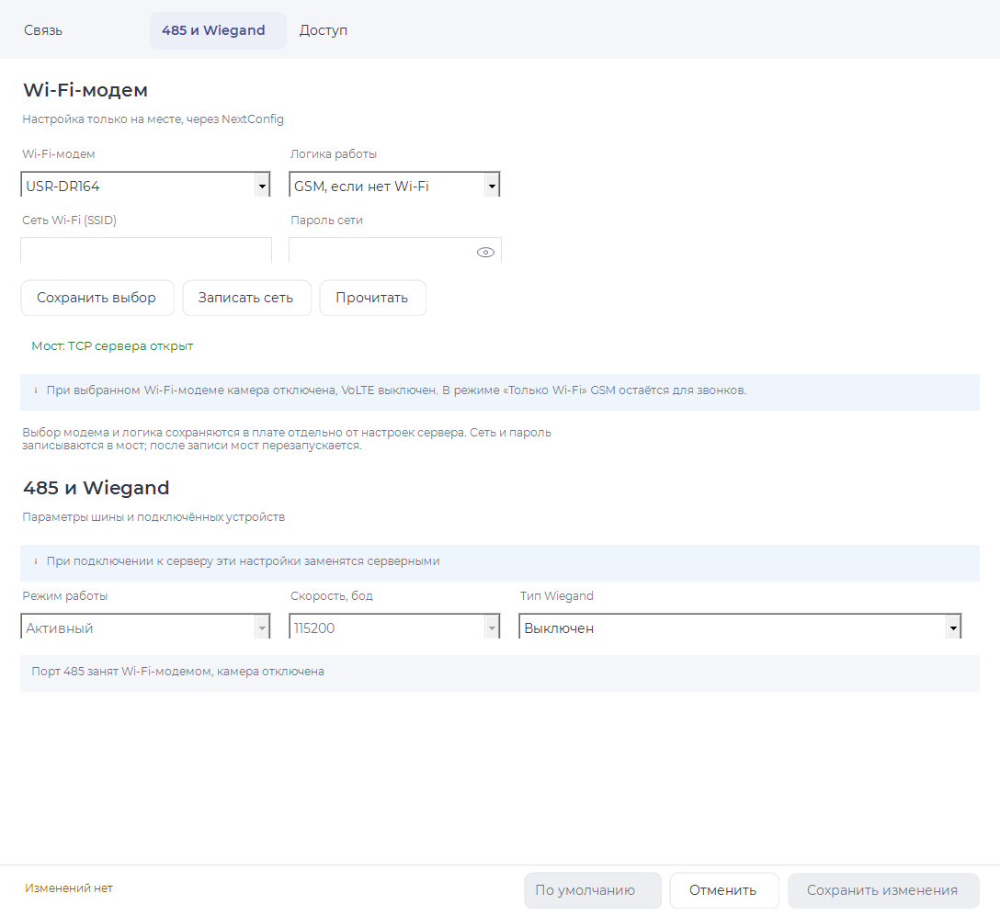

# Wi-Fi-модем и один владелец RS-485

Дата: 21.10.2026. Реализация: `task/wifi-one` от `2334b67`, NextConfig `task/port485` от `625b9f5`. Первоначальное предложение c43846a заменено решениями владельца о локальном device и источниках сброса. Прозрачный режим сохранён.

## Границы работы

Плату №1 не прошивали, не перезагружали, COM не открывали. Настройки DR164 и сервер не меняли. Аппаратная проверка ниже — отдельная работа владельца после его «да». Все PASS здесь относятся к локальной сборке, моделям и настольному интерфейсу.

В исходном этапе разрешённое чтение UDP 48899 подтвердило ответ обнаружения DR164 на 192.168.0.105; AT-запросы чтения не дали пригодного ответа. Это не проверка TCPDIS на установленной версии моста. Указанные владельцем код платы 908887a и сборка 1792591790 в этой работе с платы не считывались. Файл BRIDGE_FRAMES_20261021.md в доступных двух деревьях не найден; использованы прямые руководства производителя, приведённые ниже.

## Исправления и локальный договор

- Раньше W_DIS_OFF немедленно включал TCP перед паузой, а wifi_retry закрывал GSM до проверки моста. Теперь ожидание, закрытие и уход на GSM выключают TCP; включение разрешено только при открытии сеанса. Начальная настройка сохраняет `TCPDIS=off,1`, сокет B выключен. Открытие — `on,0`, обычное закрытие — `off,0`. После AT+Z снова отправляется явный off.
- WSLK и PING проверяют мост через отдельный короткий буфер при работающем GSM. Только успешная проверка позволяет закрыть GSM; переключение ждёт завершённого закрытия/проверки старого сокета. Отказ регистрации возвращает GSM, следующие попытки через 10/30/60 минут. Успешная регистрация сбрасывает ступень.
- «Только Wi-Fi» не открывает серверный TCP через GSM; модем остаётся зарегистрирован для звонков. «Только GSM» при выбранном USR держит мост выключенным, но порт остаётся зарезервирован за ним.
- Wi-Fi выбирается только локально. `device_s`: байты 221..224 — `wifiModem`, `wifiMode`, `wifiStop`, `wifiMark=0x57`; размер device 512 Б и CRC на 510 не изменены. Старые нули/FF и неверные значения не включают Wi-Fi. Использован свободный reserv после прежних 40 байт курсоров. При старте device восстанавливается **до** запуска связи.
- Команда 12 и таблица 485 не меняют выбор. Новый адрес/выбор сервера после verify сбрасывает готовность NETP. До свободного слота настройка откладывается. Саму таблицу сервера сохраняем без смены формата.
- При выбранном модеме UART 485 работает на 115200, серверные режим/скорость/таблица для физического порта не применяются. Команда 7 и фото по выходу получают отказ; само действие реле сохраняется. Без Wi-Fi прежний путь камеры сохранён. VoLTE принудительно запрещён эффективным callback, поле сервера не переписывается.
- Совместные состояния WF_CAMERA, W_CAMERA_OFF/ON, paused и API wifi_pause удалены. `wf_line[96]` и hold/unhold нужны: во время передачи общего frame и фоновой проверки GSM ответ моста должен попадать в отдельный буфер.
- EVENT вне бинарного SLDN фиксирует смену TCP-сеанса. Строка EVENT внутри тела/CRC пакета не трактуется как событие; учитывается дробление UART. TCPLK остаётся резервным опросом состояния, с паузой 50 мс после полезной передачи.

### USB

| Команда | Договор |
|---|---|
| 114, тело `[modem, policy]` | Только USB после авторизации; modem 0/1, policy 0/1/2. Для modem=0 допустим только policy=0. Ответ 11 с успехом — после атомарной записи и verify; при отказе прежний выбор остаётся действующим. |
| 113, пустое тело | Ответ `[bridgeChannel, bridgeState, 1, modem, policy, actualChannel]`. Первые два байта сохраняют прежнее расположение; actualChannel: 0 — нет данных, 1 — Wi-Fi, 2 — 2G, 4 — 4G. |
| 113, SSID NUL key NUL | Прежняя запись сети/пароля в мост. Ответ 2 байта означает принятие задания, а не доказательство успешного подключения; итог виден в статусе. |

bridgeState: 0 — нет подтверждённой связи, 1 — мост ответил, TCP не подтверждён, 2 — TCP открыт, 3 — TCP выключен с подтверждением, 4 — выключение не подтверждено, 5 — выполняется выключение. NextConfig с прежним двухбайтным ответом не предлагает запись неподдерживаемого локального выбора.

## Выключение и сбросы

При выключении выполняются три USRAT+TCPDIS=off и, если нет +ok, одна попытка обычного AT+TCPDIS=off (мог остаться командный режим). Таймаут одного ответа 800 мс. До завершения попыток камера не допускается. После четырёх неудач порт освобождается, сохраняется долг выключения и событие 41 «Мост не ответил на выключение». При следующем запуске попытка повторяется; перед отправкой проверяется, что камера не снимает.

| Источник | Выбор Wi-Fi | Мост / порт |
|---|---|---|
| Сервер, команда 3 по серверному каналу / WEB | Сохраняется | Настройки контроллера сбрасываются; выбранный мост остаётся владельцем порта, TCP заново управляется автоматом. |
| Автоматический сброс по отказу регистрации «неизвестен / не привязан» | Сохраняется | Как удалённый источник; не посылается лишний ответ 3. |
| SMS DEFAULT | Сохраняется | Удалённый источник: тот же консервативный выбор, что для сервера. |
| NextConfig «По умолчанию» | Не выбран / Только GSM | Сначала USB114 сохраняет выключение; затем обычная запись конфигурации. До ACK off или исчерпания попыток порт не отдаётся камере. |
| Заводской сброс командой 3 по USB | Не выбран / Только GSM | Полная очистка с сохранением долга выключения; затем off по указанной процедуре. |
| PA14/JMP1 при включении питания | Не выбран / Только GSM | Тот же user_factoryReset и выключение; событие сброса с источником «кнопка». |
| Следующее включение с долгом выключения | Выбор не меняется | Повтор off только вне активной съёмки; ACK очищает долг, молчание снова освобождает порт. |

Событие заводских настроек остаётся типом 0. В поле ID передаётся десятичный источник: 0 USB, 1 сервер, 2 SMS, 3 серверный автомат, 4 кнопка, 5 восстановление отсутствующей/повреждённой конфигурации. NextConfig расшифровывает источник. Событие 41 и источник типа 0 уходят серверу существующим пакетом журнала; серверную подпись и отображение на действующем сервере не проверяли и не меняли.

### PA14 и SWD

Сверены старые v5 main.c:74–84, board.c:68–73 и текущий board.c. PA13 остаётся входом загрузчика; PA14 добавлен входом с подтяжкой вверх. На холодном POR/PDR старте приложение проверяет землю трижды (t=0, 50, 100 мс), после третьего нуля вызывает user_factoryReset один раз. Отпускание на любой проверке отменяет действие. WDT, программный сброс и нажатие после старта его не вызывают. POR-флаг анализируется до его очистки.

Текущий загрузчик уже вызывает GPIO_Remap_SWJ_Disable (Bootloader/boot_platform.c:142): JTAG и SWD выключены до приложения. Новая настройка PA14 не добавляет отключения отладки. Обычная SWD-отладка после этого недоступна, а SWCLK физически совпадает с PA14: подключённый отладчик может задавать уровень входа JMP1. Проверку кнопки выполнять без управления этой линией отладчиком. Загрузчик и обработка PA13 не изменены.

## Что говорит руководство DR164

[AT Command Set V2.0](https://www.pusr.com/uploads/20260108/211d8af5bc2e02d0e5b6010f7caee1b0.pdf): §3.8, **с.17** — opt=0/отсутствует не сохраняет TCPDIS, после рестарта описан on; opt=1 сохраняет параметр во flash. Поэтому начальное off сохраняется, а после AT+Z off повторяется явно. §3.12, **с.19** — аналогичный параметр сокета B.

§3.7–3.8, **с.16–17** описывают автоматическое переподключение клиента. Документированной команды «одна попытка TCP» или интервала повторов не найдено. TCPTO — таймаут отсутствия данных, а не задержка переподключения. §1.4, **с.8** — EVENT=on выдаёт SOCKA_ON/OFF, настройка действует после рестарта; TCPLK (§3.6, **с.16**) показывает текущее состояние, не поколение соединения.

[Руководство пользователя](https://www.pusr.com/uploads/20260108/b3e69e40904adb82d6cb31cfbebbcc36.pdf), §6.2, **с.28** — настройка/чтение через UDP 48899. Проверку сохранения opt=1 на установленной версии DR164 необходимо выполнить владельцу на стенде.

**Граница гарантии:** модель даёт ноль пустых подключений в паузе после подтверждённого off. Между FIN сервера и обработкой off мост ещё может сам переподключиться. При молчании моста подтверждения выключения нет: по решению владельца после четырёх попыток порт всё равно освобождается. Нельзя выдавать это за физически доказанный ноль подключений.

## Прозрачный режим и socket B

| Показатель | Прозрачная база 2334b67 | B, 0386798 | Итог прозрачного |
|---|---:|---:|---:|
| BIN Release, Б | 92054 | 91022 | 92046 |
| BIN ReleaseCustomer, Б | 90072 | 89016 | 90056 |
| RW data Release, Б | 19699 | 19707 | 19699 |
| RW data Customer, Б | 19355 | 19363 | 19355 |
| RAM code, Б | 476 | 476 | 476 |
| wf / wf_line, Б | 36 / 96 | 44 / 96 | 36 / 96 |
| Значений W_*, включая NONE | 20 | 22 | 16 |

B измерен на его существующей ветке, **без** новых требований локального выбора/сбросов. Сравнение не является ценой переноса всех исправлений на B. У B меньше исходный BIN, но уже +8 Б RAM против допуска +2 Б, больше состояний и отдельные фазы отправки/приёма.

Прозрачный канал передаёт полезный кадр одной посылкой; TCPLK раз в 5 с: 12 Б запроса + около 10 Б ответа = 4,4 Б/с в покое. B опрашивает AT+RCVB=512,0 через 50 мс: до 20 обменов/с, 14+9 Б без данных = до 460 Б/с плюс TCPLKB. Это около 4% линии 115200 8N1; фактически меньше из-за ответов/поворота линии. У B также пауза W_HOLD 30 мс после отправки. Камера больше не требует освобождать линию, поэтому остаётся выбранный владельцем прозрачный режим: меньше состояний и служебного обмена. Совмещение AT и бинарных данных всё равно требует аппаратной проверки.

## Память и проверки

IAR EWARM 9.2, исходные Release/ReleaseCustomer, без изменения настроек компилятора/линкера. База собрана отдельно. Итог: **BIN −8/−16 Б, RAM +0/+0 Б**, лимит выполнен. CSTACK 4096 Б не увеличен. Экономия получена удалением совместного пути камеры, общей таблицей команд DR164, таблицами неизменных сохраняемых полей/границ строк и устранением повторных проверок фильтра USB-журнала (сам usb_log по-прежнему фильтрует записи). Выборочные forced-inline оставлены только по замеру BIN. Набор восстанавливаемых полей и все семь строковых границ проверены на ELF.

| Проверка | Результат |
|---|---|
| check.py --quick --config Release | PASS, 12/12 |
| check.py --quick --config ReleaseCustomer | PASS, 12/12; добавлен выбор профиля для --quick |
| Host-модель связи, Zig + UBSan, halt on error | PASS: обычный сеанс, off в паузе, отсутствующий мост без разрыва GSM, WSLK/PING, возврат, 10/30/60 мин, NETP, Only Wi-Fi, четыре попытки off, долг/камера |
| test_wifi_local_elf.py, оба профиля | PASS: USB114 verify/отказ, серверная 12, startup, старый device, VoLTE, все источники сброса, PA14, поля/строки, запрет камеры |
| ELF photo / photo access, оба профиля | PASS: обычная камера, реальный путь выхода и отсутствие съёмки при Wi-Fi |
| comm_review_host.py | PASS: локальный выбор вместо типа 1 в таблице |
| NextConfig Release | PASS; прежние предупреждения BC42030 по rec остаются |
| tests/ NextConfig | PASS: 16 исходных/новых offline-групп, дополнительно protocol, network (17), photo-read (28), rounded-layout (78); Wi-Fi UI 17, USB-журнал 251 |

Все артефакты сборок/логов находятся в `%TEMP%/domovoi-wifi-one-20261021`, результаты NextConfig — `%TEMP%/nextconfig-wifi-*`. Сводка размеров и SHA256 приложена в WIFI_ONE_PORT_20261021_results.json. Никакой PASS не означает проверку физической линии, радио, сервера или платы.

Из ранее помеченных «Проверено на плате» изменены comm_channel_reopen, comm_server_poll, user_command_ready и автомат comm_wifi.inc; комментарии дополнены пометкой о непроверенной на плате версии. Удаление API камеры требует нового стендового подтверждения.

## NextConfig

Раздел «Wi-Fi-модем»: модель, логика, SSID/пароль, отдельные действия сохранить локальный выбор / записать сеть / прочитать. Секция 485 показывает занятие порта и отключает редактирование таблицы/скорости; Wiegand остаётся доступным. Серверная таблица 8 строк сохраняет прежний формат. Подпись о замене настроек сервером относится к секции 485 и оставлена. На первой странице — одна строка текущего канала, в разделе — состояние моста. Серый — выключено/ожидание, зелёный — подтверждено, красный — отказ. Применён NAVISET_STYLE.md.

Снимок получен офлайн из собранного Release через WinForms DrawToBitmap, без конструктора транспорта/COM.

## План проверки платы №1 с нашим «Нависетом» — выполняет владелец

1. Получить отдельное «да» владельца на прошивку/записи/питание. До этого не выполнять ни один шаг, меняющий оборудование. Сохранить BIN отката 908887a/1792591790, текущие 512 Б config/device, SSID/NETP и версию DR164 разрешённым чтением. Подготовить независимый USB–RS485 захват и согласованный захват TCP на тестовом «Нависете»; gate не использовать.
2. По разрешению установить проверенный BIN, проверить версию. При выборе «не выбран» убедиться в обычной связи GSM и обычной съёмке C328. PA13 отдельно проверить на штатный вход загрузчика.
3. Подключить только DR164, выбрать USR-DR164 / «GSM, если нет Wi-Fi», записать тестовую сеть. Проверить off,1 до настройки, явный off после AT+Z, on только перед регистрацией; принять регистрацию и статусы нашим «Нависетом».
4. Закрыть сеанс тестовым сервером. Зафиксировать EVENT, off/+ok и паузу 30/60 с. Считать TCP SYN/пустые сеансы **после ACK off**: должно быть 0. Отдельно посчитать окно до ACK, не смешивать его с паузой.
5. Убрать мост или AP. При работающем GSM дождаться очередной 10-минутной проверки: GSM TCP не должен закрыться. Вернуть AP: WSLK и PING успешны, затем закрытие GSM подтверждено, затем одна регистрация Wi-Fi.
6. На тестовом сервере отклонять регистрацию: измерить 10, 30, 60 минут; GSM обслуживает данные между попытками. Принять регистрацию и проверить сброс ступени. Проверить «Только Wi-Fi»: никаких GSM TCP, входящие звонки сохраняются, VoLTE выключен.
7. Командой 12 назначить другой адрес тестового сервера: проверить новый NETP и регистрацию без перезагрузки платы. Синхронизировать таблицу 485 с камерой и мостом, пассивным режимом и другой скоростью: локальный выбор не меняется, фото 7 и фото по выходу не стартуют.
8. Проверить строки таблицы сбросов: серверная 3/WEB сохраняет выбор; USB/«По умолчанию» снимают его. Видеть три USR и четвёртый обычный AT при отсутствии ответа, событие 41, освобождение порта и повтор после следующего включения вне съёмки. При нормальном +ok долг очищается.
9. Только после разрешения на потерю настроек: PA14 на землю до подачи питания, PA13 свободен. Три проверки за 100 мс, одна очистка, событие «кнопка», Wi-Fi снят, мост выключен либо журналирует отказ. Отпустить между проверками — очистки нет; держать после старта — повтора нет; WDT/программный рестарт при удержании — новой очистки нет.
10. Подтвердить на этой версии DR164 сохранение off,1 после AT+Z и отключения питания. После снятия Wi-Fi установить камеру и снять JPEG; убедиться, что отложенный off не вмешивается в её кадры. Сохранить журналы, версии, HEX линии и TCP-захват; при расхождении вернуть сохранённый образ/настройки только с отдельным разрешением.
